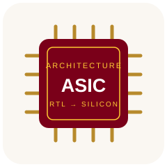

<h1 align="center">Hi, I'm Ruihong Yin 👋</h1>

  <strong>Ph.D. Student at the University of Minnesota</strong> 
  ASIC Design · Computer Architecture · AI for Hardware Design

  <a href="https://github.com/RuihongY/verdi_bridge">Verdi Bridge</a> ·
  <a href="https://github.com/RuihongY/axi-compliance-skill">AXI Compliance Skill</a>

---

I'm a Ph.D. student at the **University of Minnesota**, working on **ASIC design** with hands-on experience across **multiple chip tapeouts**.

I'm also interested in **computer architecture** and exploring how architectural ideas translate into hardware. Recently, I've been building open-source tools that connect **AI agents with hardware design and debugging workflows**.

- 🔬 **Working on:** ASIC design and chip implementation.
- 🧠 **Exploring:** computer architecture and AI-assisted hardware debugging.
- 🛠️ **Building:** practical tools for inspecting RTL, checking protocols, and understanding waveforms.
- 💬 **Happy to discuss:** chip design, tapeout experiences, architecture, and open-source EDA.

 

### Open-source projects

| Project | What I'm building |
| :--- | :--- |
| [**Verdi Bridge**](https://github.com/RuihongY/verdi_bridge) | Connect AI agents to a live Synopsys Verdi session through MCP to inspect waveforms, trace signal drivers, and navigate RTL. |
| [**AXI Compliance Skill**](https://github.com/RuihongY/axi-compliance-skill) | An agent skill for checking AXI4-Stream protocol compliance. |

From architectural ideas to RTL, waveforms, and silicon.

